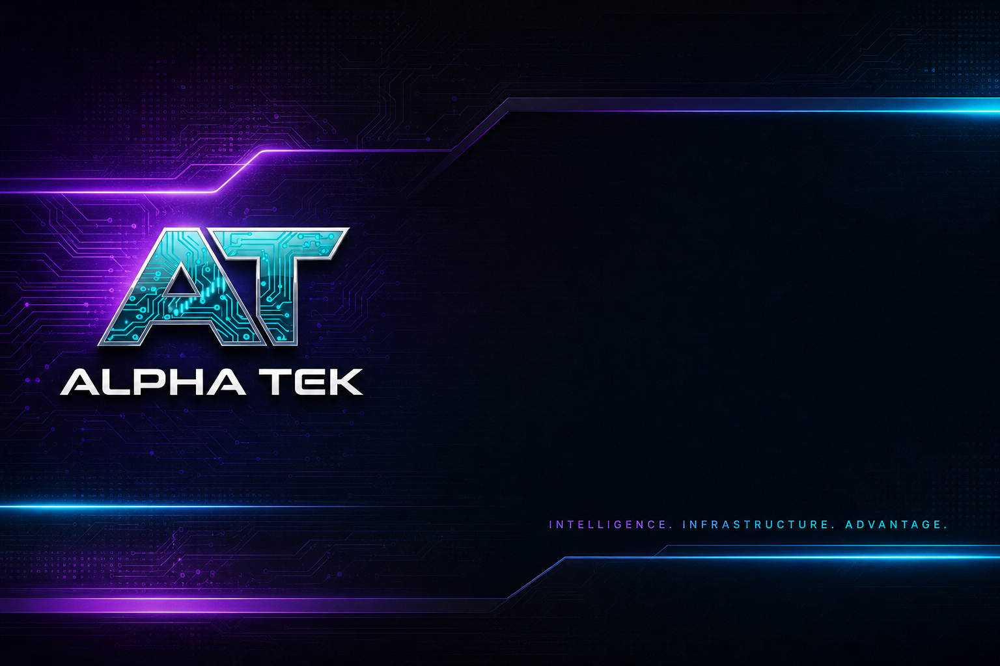

<!--
  PUBLIC product footprint — Epic Alpha / Alpha Tek Discord.
  Channels and command families only. No bot source, keys, or worker maps.
-->

<p align="center">
  <a href="https://discord.gg/EpicAlpha">
    
  </a>
</p>

<div align="center">

  <h1>Epic Alpha Discord</h1>

  <p>
    <strong>The Alpha Tek Discord Product</strong><br />
    <sub>Free intelligence community · Hundreds of automated Tek channels · Command surface · Safety stack</sub>
  </p>

  <p>
    Discord is where Alpha Tek lived first: free tools, free feeds, free culture —
    then the portal, the trench client, and AAI utility so the free layer can survive.
  </p>

  <p>
    <a href="https://discord.gg/EpicAlpha">
      
    </a>
    &nbsp;
    <a href="https://www.alphatek.app">
      
    </a>
    &nbsp;
    <a href="https://www.alphatek.app/changelog">
      
    </a>
  </p>

  <p>
    
    
    
    
  </p>

</div>

---

## What This Repo Is

Public **product map** for the **Epic Alpha** Discord server and the **Alpha Tek** command / channel product family.

| Included | Not included |
|----------|----------------|
| Channel families, command categories, safety posture | Bot source code |
| How Discord connects to the portal + Alpha Trench | Session strings · bridge keys · worker layouts |
| Join links and free-first mission | Internal alert routing diagrams |

Production bot and bridge repositories stay **private**. You experience the product by joining the server.

**Join:** [discord.gg/EpicAlpha](https://discord.gg/EpicAlpha)

---

## Why Discord Still Matters

The web portal is the research cockpit. Discord is the **always-on war room**:

- Automated radars that do not sleep  
- Commands that answer in-channel without leaving chat  
- Community receipts (calls, P&L culture, roles, XP)  
- Free on-ramps for people who will never open another SaaS trial  

Alpha Tek Discord is not a marketing server with one announcement channel. It is a **Tek stack** — hundreds of specialized feeds + command systems + monitors.

---

## Discord Tek Stack (Product Map)

### Alpha HQ — Onboarding & Community Core

| Area | What you’ll find |
|------|------------------|
| **Onboarding** | Lobby, unlock, rules, updates, sneak peaks |
| **Chat & AI** | General chat, public bot space, Alpha AI chat |
| **Chain calls / trading** | BTC · SOL · BSC · ETH · BASE · XRP · Monad-class rooms |
| **Analysis** | Prediction markets, perps, journal, conviction plays |
| **Proof culture** | Call receipts, P&amp;L shares, wallets, testimonials, feedback |

### Pump.fun Radars

Launch size ladders, runners, graduated, live / bonding / mint feeds — structured for Solana trench operators who live in new-pair velocity.

### Solana Radars

Dashboard, launchpad radar, market temperature, alpha radar / leads / runners, holder velocity and spike patterns, virality, fee and category heat, DEX boost context.

### KOL / Dev Monitors

Alpha / KOL / whale trackers, buy / sell SOL KOL flows, market-cap tier boards, day / 7-day / 30-day KOL ranks, venue-spy style suites across major Solana launch rails.

### Alpha Radars — Multichain Trending

Per-chain trending rooms (Solana, Ethereum, BNB, Base, Avalanche, Pulse, Polygon, Arbitrum, Ronin, Linea, Optimism, multi-chain tracker).

### Alpha Central — News & Macro Radars

Crypto + world + market radars (BTC / SOL / ETH news packs, policy / Fed / AP-class inputs, TikTok / Bags-style social radars, regional trend rooms).

### Alpha Trackers — Curated X / KOL Feeds

Curated influencer and research packs: alpha hunters, AI / tech, founders, macro, meme influencers, prediction markets, on-chain analysts, scam / hack detectors, regulation, sentiment metrics, wall-street news — plus list and threshold feeder channels.

### Alpha Tools

Market cycle / fear-greed / alt-season indices, whale and unusual-flow style signals, surge / graduation / DCA monitors, AI analyzers, Polymarket suite (health, radar, volume leaders, PnL, copy-trade context), DEX / pool tools.

### Stocks / Options Rooms

Flow and conviction-style option / equity lanes for operators who cross asset classes.

### Alpha Den — Education & Lounges

Extensions / tools info, trade settings, KOL wallets, Dune / VC resources, scam watch, memecoin literacy, lounges (charting, news, traders, meme, YouTube), XP / roles / certified culture.

### Call Bots & Monitor Stack

Specialized call presets (liquidity / sniper / insider / momentum / social pulse and more) with execution framing and links out for verification. Monitor channels for paper, live bot health, hourly performance, filter system health, error alerts, cabal correlation, and KOL discovery — **ops visibility, not black-box spam**.

### Signature Daily Products

| Product | What it is |
|---------|------------|
| **Crypto Morning Brief** | Data + AI morning pack (majors, narratives, memecoins, traditional risk proxies) |
| **Bloomberg-style market report** | Terminal-snapshot market report lane (continuous refinement) |

---

## Commands (How You Use The Product)

Command groups (prefix families evolve over time; server help is authoritative):

| Family (concept) | Job |
|------------------|-----|
| **Analytics / quotes** | Market and token intel |
| **DEX / launch helpers** | Pair context, launch workflows |
| **KOL / social** | Rankings, wallets, social heat |
| **Safety / Guard** | Link / host / wallet risk language |
| **System / premium** | Access, settings, premium rails |
| **Paper / tools** | Practice and utility commands |

Exact command catalogs live **inside Discord** (help menus, pinned docs, live bot). This footprint refuses to freeze a stale command spreadsheet that drifts from production.

---

## Volume & Reliability (Why It’s Credible)

Production footprint (public narrative numbers from the founder’s shipping record — verify culture by living on the server):

- **200+** specialized Tek channels  
- **Hundreds** of Discord commands across the bot product  
- **Tens of millions** of data embeds delivered historically with hard reliability targets  
- Health heartbeats, system reports, filter monitors, and dedicated error alert lanes  

This is **replication cost**: years of channel design, feed tuning, and operational discipline — not a weekend bot template.

---

## How Discord Connects To The Rest Of Alpha Tek

```text
Epic Alpha Discord
   ├─ free feeds + commands ──► operators live here
   ├─ Guard / safety language ──► same Alpha brand as portal + Trench
   ├─ calls / receipts culture ──► proof, not vibes
   └─ deepen ──► alphatek.app · Alpha Trench extension · AAI hub
```

| Sibling product | Link |
|-----------------|------|
| **Web portal** | [alpha-tek-portal](https://github.com/JohnnyxSmokes/alpha-tek-portal) · [alphatek.app](https://www.alphatek.app) |
| **Alpha Trench** | [alpha-trench](https://github.com/JohnnyxSmokes/alpha-trench) |
| **Ecosystem whitepaper** | [alpha-tek-whitepaper](https://github.com/JohnnyxSmokes/alpha-tek-whitepaper) |

Licensing the Discord Tek product for other communities is a **revenue pillar** (tiered bot / pack licensing) so free community value does not depend on founder burnout forever.

---

## Free First, Then Sustainable

| Layer | What users get |
|-------|----------------|
| **Free** | Join, feed, learn, use free commands and culture |
| **Deeper** | Portal subscription surfaces + premium Discord rails |
| **Utility** | AAI for tiers / staking / credits when you want the economy |

Mission never changed: **give back real intel**. Economics changed so the give-back can continue.

---

## Safety Culture

- Dedicated moderation and alert infrastructure  
- Cabal correlation / cluster awareness products  
- Alpha Guard branding alignment with portal + browser extension  
- Founder-operated reliability mentality (BTC 2012 OG discipline)  

Still DYOR. No automated feed is financial advice. Use verification links; never trust a single channel as truth.

---

## Join

**https://discord.gg/EpicAlpha**

Then: pick a chain room · open a radar · read pins · ask in HQ · open [AlphaTek.App](https://www.alphatek.app) when you need the full portal.

---

<div align="center">

  <sub>
    Epic Alpha Discord · Alpha Tek Discord product footprint · Bot source private<br />
    Built with passion since BTC 2012 · Free tools first
  </sub>

</div>
