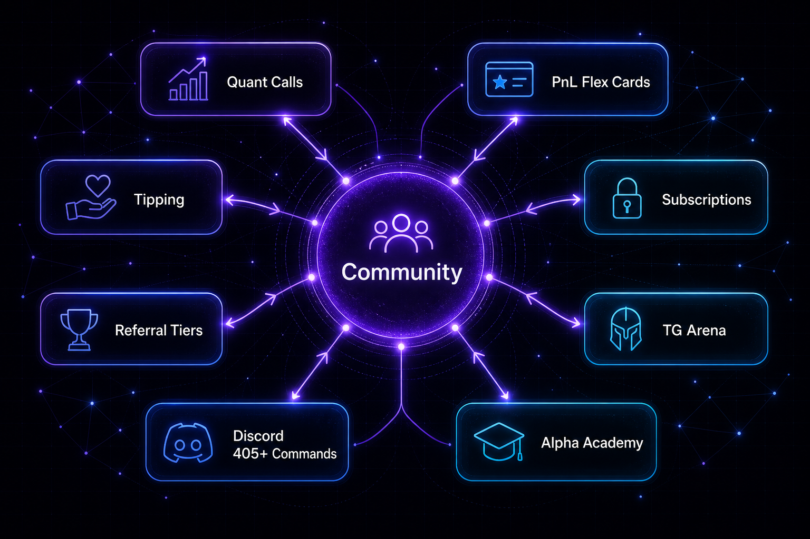

<!--
  PUBLIC product footprint. Epic Alpha / Alpha Tek Discord.
  Channels and command families only. No bot source, keys, or worker maps.
-->

<p align="center">
  <a href="https://discord.gg/sPW3tJk">
    
  </a>
</p>

<div align="center">

  <h1>Epic Alpha Discord</h1>

  <p>
    <strong>The Alpha Tek community and command stack.</strong><br />
    <sub>200+ Tek channels · 405+ commands · Safety stack · discord.gg/sPW3tJk</sub>
  </p>

  <p>
    For more than three years, Epic Alpha offered free tools, alpha, and intel so newcomers and working investors could see real intelligence without enterprise prices.<br />
    That chapter is morphing into an ecosystem: <strong>subscriptions and Discord licensing</strong>, <strong>AAI utility</strong>, and the <strong>Alpha Trench extension</strong>.<br />
    The server is still the community home. Joining stays open.
  </p>

  <p>
    <a href="https://discord.gg/sPW3tJk">
      
    </a>
    &nbsp;
    <a href="https://www.alphatek.app">
      
    </a>
    &nbsp;
    <a href="https://alphatek.app/whitepaper">
      
    </a>
    &nbsp;
    <a href="https://www.alphatek.app/changelog">
      
    </a>
  </p>

  <p>
    
    
    
    
  </p>

  <p>
    <a href="https://discord.gg/sPW3tJk">
      
    </a>
  </p>

  <p>
    
  </p>

</div>

---

<div align="center">

## What This Repo Is

Public product map for the Epic Alpha Discord server and the Alpha Tek command and channel family.

<table>
  <thead>
    <tr>
      <th align="center">Included</th>
      <th align="center">Not included</th>
    </tr>
  </thead>
  <tbody>
    <tr>
      <td align="center">Channel families, command categories, safety posture</td>
      <td align="center">Bot source code</td>
    </tr>
    <tr>
      <td align="center">How Discord connects to the portal and Alpha Trench</td>
      <td align="center">Session strings, bridge keys, worker layouts</td>
    </tr>
    <tr>
      <td align="center">Join link and the three-rail operating model</td>
      <td align="center">Internal alert routing diagrams</td>
    </tr>
  </tbody>
</table>

Production bot and bridge repositories stay private. You experience the product by joining the server.

**Join:** [discord.gg/sPW3tJk](https://discord.gg/sPW3tJk)

---

## Why Discord Still Matters

The web portal is the research cockpit. Discord is the always-on community and command stack.

- Automated radars that do not sleep
- Commands that answer in channel
- Community receipts: calls, P&L culture, roles, XP
- The open door for people who are still learning the stack

Alpha Tek Discord is a Tek stack: hundreds of specialized feeds, command systems, and monitors.

---

## Discord Tek Stack

### Alpha HQ · Onboarding and Community Core

<table>
  <thead>
    <tr>
      <th align="center">Area</th>
      <th align="center">What you will find</th>
    </tr>
  </thead>
  <tbody>
    <tr>
      <td align="center"><strong>Onboarding</strong></td>
      <td align="center">Lobby, unlock, rules, updates, sneak peaks</td>
    </tr>
    <tr>
      <td align="center"><strong>Chat and AI</strong></td>
      <td align="center">General chat, public bot space, Alpha AI chat</td>
    </tr>
    <tr>
      <td align="center"><strong>Chain calls / trading</strong></td>
      <td align="center">BTC · SOL · BSC · ETH · BASE · XRP · Monad-class rooms</td>
    </tr>
    <tr>
      <td align="center"><strong>Analysis</strong></td>
      <td align="center">Prediction markets, perps, journal, conviction plays</td>
    </tr>
    <tr>
      <td align="center"><strong>Proof culture</strong></td>
      <td align="center">Call receipts, P&amp;L shares, wallets, testimonials, feedback</td>
    </tr>
  </tbody>
</table>

### Pump.fun Radars

Launch size ladders, runners, graduated, and live, bonding, and mint feeds for Solana trench operators who live in new-pair velocity.

### Solana Radars

Dashboard, launchpad radar, market temperature, alpha radar, leads, runners, holder velocity, spike patterns, virality, fee and category heat, and boost context.

### KOL and Dev Monitors

Alpha, KOL, and whale trackers, buy and sell SOL KOL flows, market-cap tier boards, day, 7-day, and 30-day KOL ranks, and venue-spy suites across major Solana launch rails.

### Alpha Radars · Multichain Trending

Per-chain trending rooms: Solana, Ethereum, BNB, Base, Avalanche, Pulse, Polygon, Arbitrum, Ronin, Linea, Optimism, and the multi-chain tracker.

### Alpha Central · News and Macro

Crypto, world, and market radars. BTC, SOL, and ETH news packs, policy and macro inputs, social radars, and regional trend rooms.

### Alpha Trackers · Curated X and KOL Feeds

Curated influencer and research packs: alpha hunters, AI and tech, founders, macro, meme influencers, prediction markets, on-chain analysts, scam and hack detectors, regulation, sentiment, and markets news, plus list and threshold feeder channels.

### Alpha Tools

Market cycle, fear and greed, and alt-season indices. Whale and unusual-flow signals. Surge, graduation, and DCA monitors. AI analyzers. Polymarket suite. Pool tools.

### Stocks and Options Rooms

Flow and conviction lanes for operators who cross asset classes.

### Alpha Den · Education and Lounges

Extensions and tools info, trade settings, KOL wallets, research resources, scam watch, memecoin literacy, lounges, XP, roles, and certified culture.

### Call Bots and Monitor Stack

Specialized call presets for liquidity, momentum, and social pulse, with links out for verification. Monitor channels cover paper, live bot health, hourly performance, filter health, error alerts, cabal correlation, and KOL discovery. Ops visibility, with the source of each alert in the open.

### Signature Daily Products

<table>
  <thead>
    <tr>
      <th align="center">Product</th>
      <th align="center">What it is</th>
    </tr>
  </thead>
  <tbody>
    <tr>
      <td align="center"><strong>Crypto Morning Brief</strong></td>
      <td align="center">Data and AI morning pack: majors, narratives, memecoins, traditional risk proxies</td>
    </tr>
    <tr>
      <td align="center"><strong>Market report lane</strong></td>
      <td align="center">Terminal-snapshot market report, refined in production</td>
    </tr>
  </tbody>
</table>

---

## Commands

Prefix families evolve. Server help is authoritative.

<table>
  <thead>
    <tr>
      <th align="center">Family</th>
      <th align="center">Job</th>
    </tr>
  </thead>
  <tbody>
    <tr>
      <td align="center"><strong>Analytics / quotes</strong></td>
      <td align="center">Market and token intel</td>
    </tr>
    <tr>
      <td align="center"><strong>DEX / launch helpers</strong></td>
      <td align="center">Pair context, launch workflows</td>
    </tr>
    <tr>
      <td align="center"><strong>KOL / social</strong></td>
      <td align="center">Rankings, wallets, social heat</td>
    </tr>
    <tr>
      <td align="center"><strong>Safety / Guard</strong></td>
      <td align="center">Link, host, and wallet risk language</td>
    </tr>
    <tr>
      <td align="center"><strong>System / premium</strong></td>
      <td align="center">Access, settings, premium rails</td>
    </tr>
    <tr>
      <td align="center"><strong>Paper / tools</strong></td>
      <td align="center">Practice and utility commands</td>
    </tr>
  </tbody>
</table>

Exact command catalogs live inside Discord. This page does not freeze a spreadsheet that drifts from production.

---

## Volume and Reliability

- **200+** specialized Tek channels
- **405+** Discord commands across the bot product
- **Tens of millions** of data embeds delivered, with health heartbeats, system reports, filter monitors, and error alert lanes

This is replication cost: years of channel design, feed tuning, and operational discipline.

---

## How Discord Connects

```text
Epic Alpha Discord
   |  community, feeds, and commands
   |  Guard language shared with the portal and Trench
   |  calls and receipts
   +-> alphatek.app · Alpha Trench 0.9.542 · AAI Hub
```

<table>
  <thead>
    <tr>
      <th align="center">Sibling</th>
      <th align="center">Link</th>
    </tr>
  </thead>
  <tbody>
    <tr>
      <td align="center"><strong>Web portal</strong></td>
      <td align="center"><a href="https://github.com/JohnnyxSmokes/alpha-tek-portal">alpha-tek-portal</a> · <a href="https://www.alphatek.app">alphatek.app</a></td>
    </tr>
    <tr>
      <td align="center"><strong>Alpha Trench</strong></td>
      <td align="center"><a href="https://alphatek.app/alpha-trench">Windows 0.9.542</a> · <a href="https://alphatek.app/alpha-trench/safari">Safari 0.9.542</a></td>
    </tr>
    <tr>
      <td align="center"><strong>Whitepapers</strong></td>
      <td align="center"><a href="https://github.com/JohnnyxSmokes/alpha-tek-whitepaper">Platform 1.3 · AAI 2.1</a></td>
    </tr>
    <tr>
      <td align="center"><strong>Licensing</strong></td>
      <td align="center"><a href="https://github.com/JohnnyxSmokes/discord-licensing">discord-licensing</a></td>
    </tr>
    <tr>
      <td align="center"><strong>AAI Hub</strong></td>
      <td align="center"><a href="https://github.com/JohnnyxSmokes/aai-hub">aai-hub</a> · <a href="https://www.alphatek.app/dashboard/aai">Open hub</a></td>
    </tr>
  </tbody>
</table>

Licensing the Discord Tek product for other communities is a revenue rail, so the community home does not depend on one builder funding the stack.

---

## Three Rails

<table>
  <thead>
    <tr>
      <th align="center">Rail</th>
      <th align="center">What it does</th>
    </tr>
  </thead>
  <tbody>
    <tr>
      <td align="center"><strong>Subscriptions and Discord licensing</strong></td>
      <td align="center">Paid depth on AlphaTek.App, and bot and channel packs for other communities</td>
    </tr>
    <tr>
      <td align="center"><strong>AAI utility</strong></td>
      <td align="center">Access tiers, staking, and credits. Devnet proven. Mainnet gated.</td>
    </tr>
    <tr>
      <td align="center"><strong>Alpha Trench extension</strong></td>
      <td align="center">The flywheel entry. Paper first. Version 0.9.542.</td>
    </tr>
  </tbody>
</table>

The mission is still real intel in one place. The economics changed so that mission can continue.

---

## Safety Culture

- Dedicated moderation and alert infrastructure
- Cabal correlation and cluster awareness
- Alpha Guard on Discord, the portal, and the extension
- Founder-operated reliability, BTC 2012 discipline

Still DYOR. No automated feed is financial advice. Use verification links.

---

## Join

**https://discord.gg/sPW3tJk**

Then pick a chain room, open a radar, read the pins, ask in HQ, and open [AlphaTek.App](https://www.alphatek.app) when you need the full portal.

<p>
  
</p>

<sub>
  Epic Alpha Discord · Alpha Tek community and command stack · Bot source private<br />
  Built with passion since BTC 2012 · Tampa · Core private · Public story by design
</sub>

</div>
